<div align="center">

# LIFELINE

**Every hour, it asks what you're doing. No proof, no peace.**

An Android app that keeps your day honest. An alarm rings at the top of every hour and won't stop until you log what you're actually doing: snap a photo or type it, then tag it as productivity or entertainment.

[**Download the latest APK**](https://github.com/Sakthi-Vikkraman/Lifeline/releases/latest) · [Report a bug](https://github.com/Sakthi-Vikkraman/Lifeline/issues/new) · [Apache-2.0 License](LICENSE)

</div>

<table>
  <tr>
    <td align="center">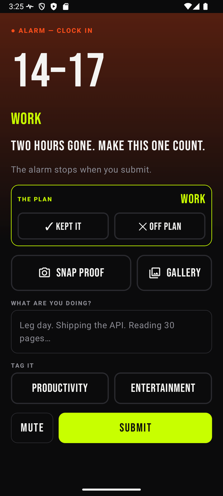<br><sub><b>Session alarm</b></sub></td>
    <td align="center">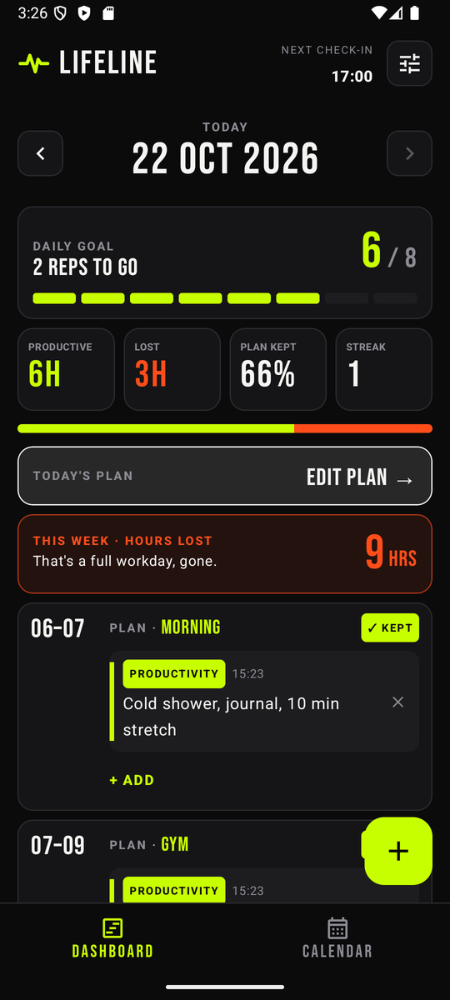<br><sub><b>Dashboard</b></sub></td>
    <td align="center">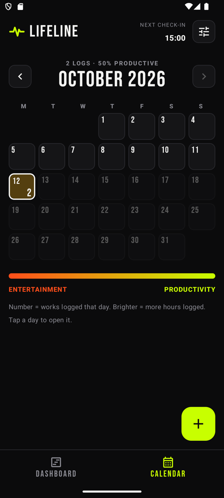<br><sub><b>Calendar</b></sub></td>
    <td align="center">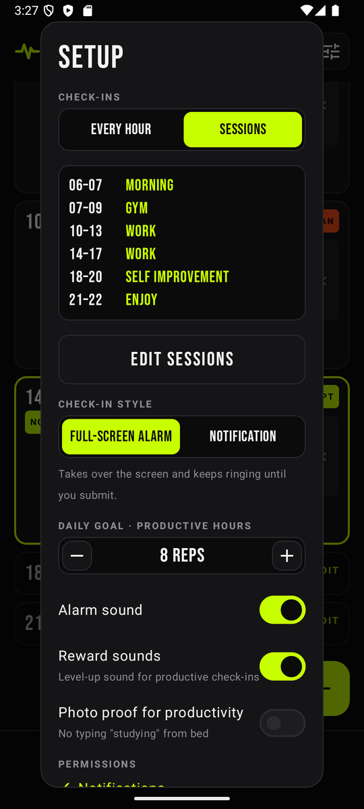<br><sub><b>Setup</b></sub></td>
  </tr>
</table>

<table>
  <tr>
    <td align="center">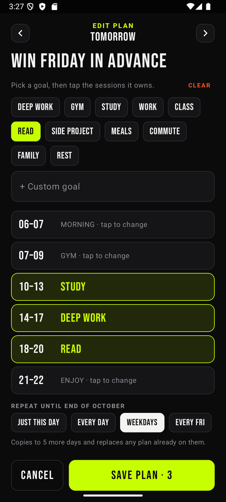<br><sub><b>Plan any day</b></sub></td>
    <td align="center">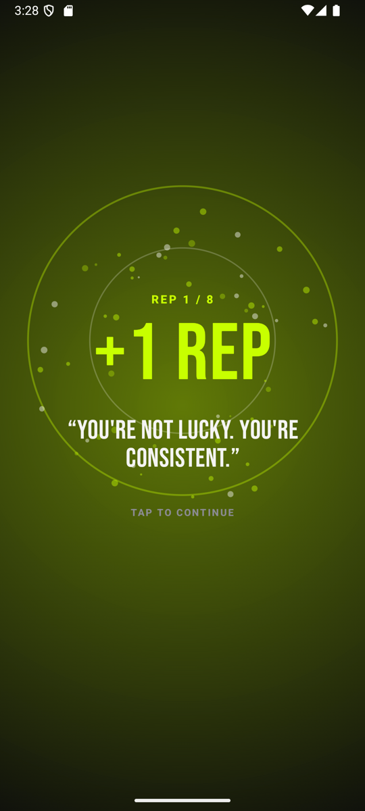<br><sub><b>+1 REP</b></sub></td>
    <td align="center">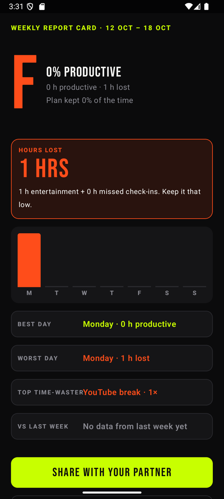<br><sub><b>Weekly report card</b></sub></td>
  </tr>
</table>

<table>
  <tr>
    <td align="center">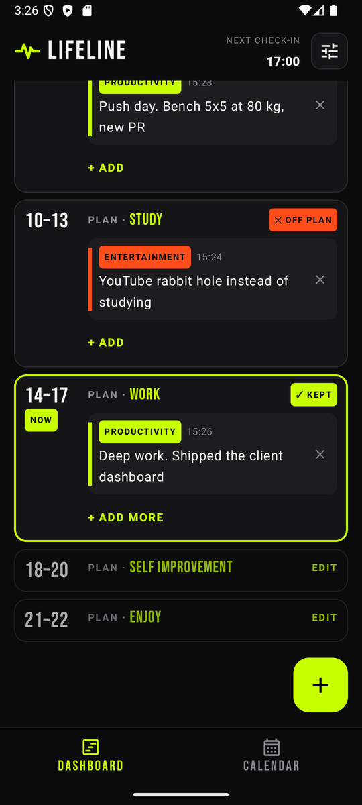<br><sub><b>Sessions</b></sub></td>
    <td align="center">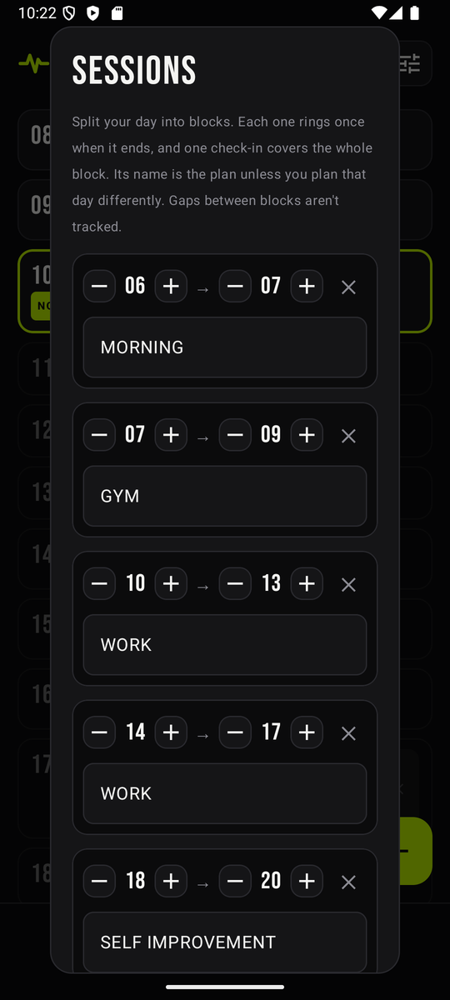<br><sub><b>Edit sessions</b></sub></td>
    <td align="center">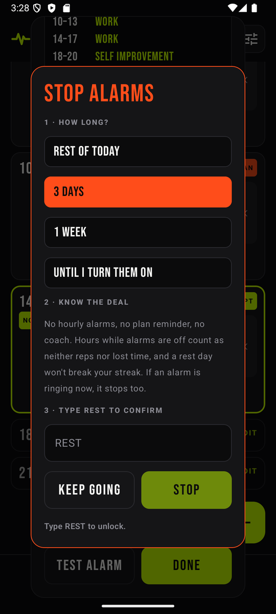<br><sub><b>Stop alarms</b></sub></td>
  </tr>
</table>

<p align="center">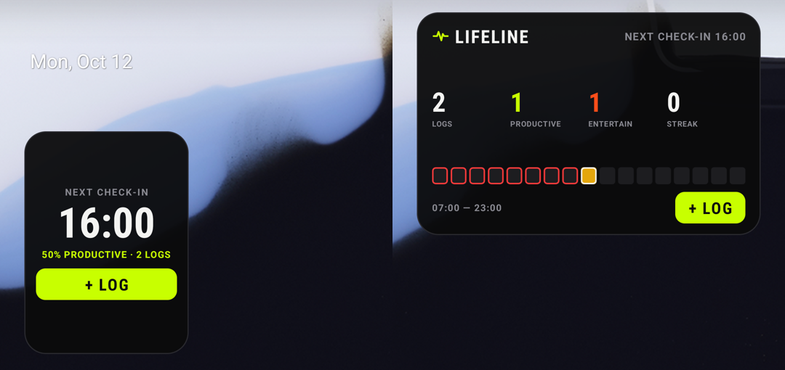<br><sub><b>Home-screen widgets</b></sub></p>

## Features

- **Hourly alarm that means it.** Rings at the top of every hour in your chosen window, even when the app is closed, after a reboot, or with the phone locked. It wakes the screen and takes it over.
- **Proof to dismiss.** The only way to stop it is to submit a check-in: a camera photo, a gallery photo, or a line of text, plus a tag. Back is blocked, the notification can't be swiped away, and Home leaves it ringing. **Mute** silences the sound but keeps the alarm until you log.
- **Or just a notification.** Prefer something quieter? Switch the check-in style to **Notification** in setup. You get one sound, you can swipe it away, and you log when you're ready. A skipped check-in still counts as lost.
- **Sessions instead of hours.** Track your day in your own blocks, like 07–09 GYM, 10–13 WORK, 14–17 WORK, 18–20 SELF IMPROVEMENT and 21–22 ENJOY. Each block rings once when it ends, and one check-in covers every hour in it. The block's name is its plan, unless you plan that day differently.
- **Productivity vs. entertainment.** Every entry is tagged, and the whole app is colored by it: neon green for productivity, blaze orange for entertainment.
- **No hiding.** A skipped check-in counts as a **lost hour**, just like entertainment, so ignoring the alarm never makes your day look better.
- **Morning plan.** Before your first alarm, give every hour a job: pick a goal (Deep work, Gym, Study…) and tap the hours it owns. Locking it in shows a striking quote to start the day.
- **Plan daily or for the month.** Edit today's plan any time from the dashboard (hours already over stay as they were), plan any day up to two months ahead, and repeat a plan to the end of the month: every day, weekdays only, or the same weekday each week.
- **Plan vs. reality.** Each check-in shows what the hour was planned for and asks whether you stuck to it. The dashboard shows plan and reality side by side, plus a daily **plan kept** score.
- **Rewards that hit.** A productive check-in plays a level-up sound with a volt burst, "+1 REP" and a motivational quote. Hitting your goal gets **GOAL CRUSHED**. Entertainment gets an honest nudge instead.
- **Daily goal as reps.** Set how many productive hours you want, e.g. 8, and the dashboard and widgets count them like a rep counter.
- **A coach in the alarm.** The alarm text reacts to your day: "Two hours gone. Make this one count." · "3 productive hours straight. Don't break it." · "The plan says: GYM. Did you show up?" If you're losing the day, a **streak in danger** warning comes in the evening.
- **Night review.** At your last alarm, a 2-minute prompt: one win, one fail, one fix for tomorrow. The fix shows up on the next morning's plan.
- **Weekly report card.** An A–F grade, hours lost ("That's almost a full day."), best and worst day, top time-waster, and a comparison with last week. Graded every Sunday night, and you can share it with an accountability partner.
- **Photo proof (optional).** Require a photo for productivity check-ins, so no typing "studying" from bed.
- **Dashboard.** Your day split hour by hour, with plans, photos, notes, tags and times. Shows productive and lost hours, plan kept, your **win streak** (days where productive hours beat lost hours), and this week's hours lost.
- **Calendar.** Each day shows how many things you logged and is colored from orange to green by its productive share, with missed hours counting as lost. The more hours you logged, the brighter the day. The weekly report card sits on top.
- **Home-screen widgets.** *Lifeline Today* (4×2) shows today's logs, the productive/entertainment counts, your streak, and a color strip with one cell per hour. *Lifeline Check-in* (2×2) shows the next check-in and today's productive %. Both have a one-tap **+ LOG** button, and both turn orange with **CLOCK IN** while an alarm is waiting.
- **Your data stays on your phone.** No account, no server, no tracking. Entries and photos are stored only on the device.

## Install

1. Download `Lifeline-vX.Y.Z.apk` from the [latest release](https://github.com/Sakthi-Vikkraman/Lifeline/releases/latest) on your Android phone.
2. Open it. If Android asks, allow installs from your browser or file manager ("Install unknown apps").
3. Open Lifeline and allow **notifications** when asked.
4. Tap the **setup** button (top right) and check that every permission shows ✓. Tap **FIX** next to anything that doesn't.
5. Tap **TEST ALARM** to see it in action.
6. Optional: long-press your home screen → **Widgets** → **Lifeline** to add a widget.

**Requirements:** Android 8.0 (Oreo) or newer.

### Permissions

| Permission | Why |
|---|---|
| Notifications | Shows the hourly alarm, plus coach notifications: the morning plan, streak warnings, the night review and the weekly report |
| Alarms & reminders (exact alarms) | Rings exactly on the hour |
| Full-screen notifications | Shows the alarm over the lock screen |
| Run at startup | Re-arms the alarm after you restart your phone |
| Vibrate | Vibrates with the alarm |

Lifeline doesn't request internet, location, contacts or storage access. Photos you take are saved inside the app.

### Taking a break

Sick day, holiday, rest week? Switch the alarms off properly instead of ignoring them:

1. Tap the **setup** button (top right).
2. Scroll to **Alarms** and tap **STOP ALARMS**.
3. Pick how long: **rest of today**, **3 days**, **1 week**, or **until I turn them back on**.
4. Type **REST** to confirm, then tap **STOP**.

Any ringing alarm stops too. While alarms are off there are no hourly alarms, no plan reminder and no coach notifications, and those hours count as neither productive nor lost. A rest day won't break your streak. Timed breaks end on their own in time for that morning's plan reminder. To come back early, open setup and tap **TURN ALARMS BACK ON**.

To stop Lifeline completely, uninstall it. Your entries are stored only on the phone, so uninstalling deletes them.

### Tips

- **Plan the night before or first thing.** The plan reminder comes 30 minutes before your first alarm. If you skip it, the first alarms of the day offer to plan after you check in.
- **Pick your hours.** By default alarms ring from 07:00 to 23:00. Change the window in setup, and it can wrap past midnight (for example 20:00 → 02:00).
- **Battery savers.** Some phones (notably Xiaomi, Oppo, Vivo, OnePlus and Samsung) aggressively stop background apps. If alarms arrive late or not at all, set Lifeline's battery usage to *Unrestricted* in Android settings.
- **Log ahead.** Logging an hour from the dashboard before its alarm fires means the alarm won't ring for that hour.

## Build from source

You'll need [Android Studio](https://developer.android.com/studio) (or JDK 17+ and the Android SDK with platform 34).

```sh
git clone https://github.com/Sakthi-Vikkraman/Lifeline.git
cd Lifeline
./gradlew assembleDebug        # Windows: gradlew.bat assembleDebug
./gradlew installDebug         # install on a connected device or emulator
```

The APK is written to `app/build/outputs/apk/debug/`.

**Stack:** Kotlin · Jetpack Compose · Material 3 · Room · Coil · AlarmManager.

## Contributing

Bug reports, ideas and fixes are welcome.

- **Found a bug?** [Open an issue](https://github.com/Sakthi-Vikkraman/Lifeline/issues/new). Include your phone model, Android version, what you expected and what happened. Screenshots help.
- **Want to fix something?** Fork the repo, make your change on a branch, and open a pull request against `main`. Keep each PR focused on one fix or feature, and describe how you tested it.

Contributions are accepted under the Apache License 2.0, the same license as the project (see Section 5 of the license).

## License

Copyright 2026 Sakthi Vikkraman R. Licensed under the [Apache License, Version 2.0](LICENSE).

You're free to use, study, modify and share the code under the license's terms: keep the copyright and [NOTICE](NOTICE), and state your changes. The license doesn't grant rights to the **Lifeline** name or logo, so modified versions should use a different name.

Bundled third-party components keep their own licenses. See [THIRD_PARTY_NOTICES.md](THIRD_PARTY_NOTICES.md).
